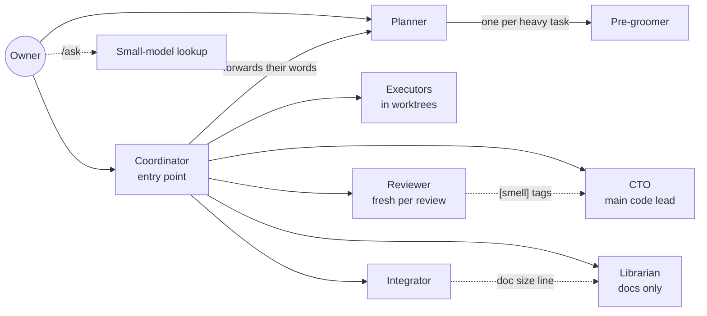
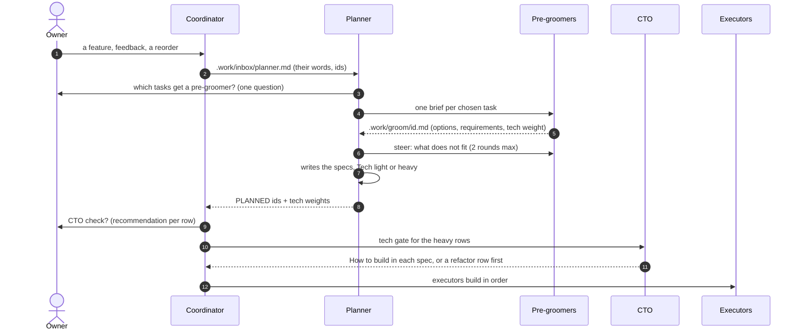
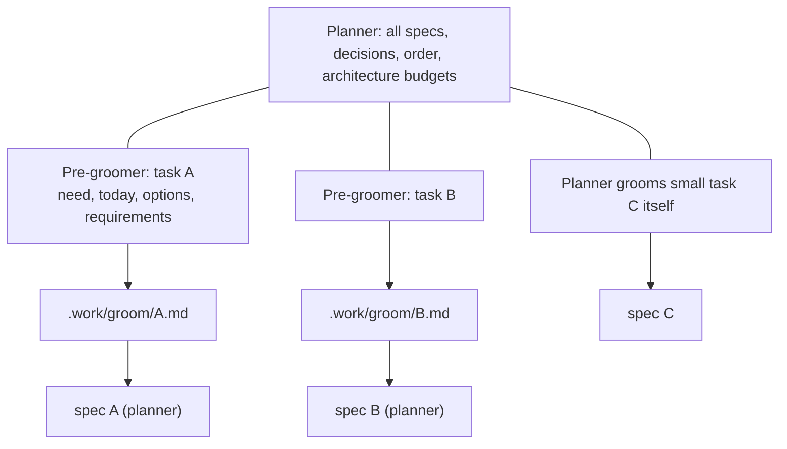
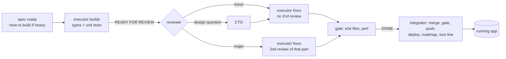
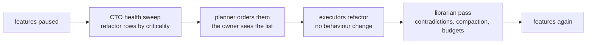

# vibecode

An opencode skill and command that set up a fresh project folder for a **multi-agent build**: you talk to one coordinator; a planner decides what to build, a CTO decides how, executors build it in worktrees, reviewers judge it before the slow tests, an integrator merges it, and a librarian keeps the docs short. Each runs in its own session, on the model that fits its job.

- [How it works](#how-it-works): the diagrams
- [The roles](#the-roles) · [Commands](#commands) · [Keeping tokens low](#keeping-tokens-low)
- [What `/vibecode` does](#what-vibecode-does) · [Install](#install) · [Usage](#usage) · [Template flags](#template-flags) · [Layout](#layout)

## How it works

### 1. Who starts whom

The owner starts two sessions: the coordinator (the entry point) and, to plan, the planner. Everything else is started by them. Any session may hand a cheap lookup to a small model.



### 2. A big task, from the owner's words to the running app

The coordinator routes; it asks the owner once whether the CTO checks the planned rows (recommended for every `Tech: heavy` row).



### 3. T-shaped grooming

The planner is the bar: it sees every spec, decision and the order. Each pre-groomer is a stem: it digs into one task with a fresh, small context and writes a report; the planner checks it against the wide view, steers it, and writes the spec itself.



### 4. The batch loop

Review before the slow tests. A design question goes to the CTO, a product question to the planner; the coordinator decides routing and slots.



### 5. Clean stages

Every ~10 feature batches, on a critical smell, or when known red tests keep growing, the coordinator proposes a stage: no new features until the code and docs are clean again. The first one is heavy.



## The roles

| Role | Does | Model (picked at setup) |
|---|---|---|
| **Coordinator** | the owner's entry point: routes what they say, runs the lanes, recommends model and effort, reports status and reminds of blockers | mid model, medium effort |
| **Planner** | grooms in breadth: vision, specs, order; asks once per pass which tasks get a pre-groomer | top model, high effort |
| **Pre-groomer** | one per heavy task (the stem of the T): options, requirements, how it should feel | top, high |
| **CTO** (main code lead) | architecture; a `How to build` section for heavy specs before they are built; health sweeps that turn smells into refactor rows with criticality (YAGNI, KISS, DRY, SOLID, DDD-lite; errors, logging, security) | top, high (xhigh for a sweep) |
| **Librarian** | docs only: contradictions, compacted decisions, stale data removed, doc size budgets so every session reads less | mid, high |
| **Executor** | builds one batch (or a chain) in its own worktree, test-first, by a short "How to build" list in the spirit of [ponytail](https://github.com/DietrichGebert/ponytail): the smallest complete change, reuse first, deletion beats addition | top, medium (high when it needs thinking) |
| **Reviewer** | reads the diff against the spec before the slow tests; tags structure problems `[smell]` for the CTO | top, high, fresh per review |
| **Integrator** | merges reviewed batches, runs the gate, pushes, deploys, writes the roadmap's "What's new" and a doc size line | top, medium |
| **Lookup helper** | `/ask`: finds a fact in the docs or code with `grep` and answers in 10 lines with `file:line` | small, low |

## Commands

Every role gets an opencode command in the new project, each setting its own model, so you can talk to any of them in a new session at any time:

`/coordinator` · `/planner <what to groom>` · `/cto <job>` · `/librarian <pass>` · `/pregroom <task>` · `/reviewer <id> base head` · `/builder <batch>` (solo) · `/ask <question>`

## Keeping tokens low

- **Cheapest tool first:** a script or `grep` (free) → a small-model lookup (`/ask`) → a larger model only for judgment.
- **Doc budgets:** the docs every session reads at its start have a size budget (`AGENTS.md` 10 KB; handover, architecture and planning 30 KB each); the integrator reports sizes after each merge and the librarian compacts what grows.
- **Held sessions:** the CTO and the librarian are kept per stage and sent each next job instead of being respawned; after a gap they are compacted first (`opencode api post /api/session/<id>/compact --data '{}'`), so the resend is a summary, not the whole history. Reviewers stay fresh for independence.
- **T-shaped grooming:** pre-groomers dig with small contexts so the planner's stays wide and short.

## What `/vibecode` does

1. **Checks the folder.** Empty or almost empty: goes on. Existing files: asks before deploying around them (nothing is ever overwritten).
2. **Takes the idea.** The command's arguments, or it asks for 2 to 5 sentences.
3. **Interviews you once** (one question-tool call): scale, reviewers, hardware, tests, how model use is paid.
4. **Probes the machines** (OS, cores, RAM, GPU, tool versions; optionally a second machine over SSH) and picks an executor count.
5. **Picks models and effort** per role from the models actually available to you.
6. **Deploys the templates** with `scripts/deploy.py`: `AGENTS.md`, `docs/` (vision, planning, backlog, roadmap, decisions, handover, machines, measurements, prompts, spec template), role briefs under `docs/workflow/` (with these diagrams as `workflow.html`), the role commands under `.opencode/commands/`, and scripts under `tools/work/` (integration, worktrees, test locks, remote runs). Then `git init` and a first commit; it never adds a remote or pushes.
7. **Prints the session prompts** with model and effort: the planner prompt to paste first, then the coordinator (or solo builder) prompt. They are also kept in `docs/PROMPTS.md`.

It writes no product code; the planner session plans the product.

## Install

Copy the two pieces into your opencode config:

```sh
cp -r skills/vibecode ~/.config/opencode/skills/
cp commands/vibecode.md ~/.config/opencode/commands/
```

Claude Code users may put the skill in `~/.claude/skills/` instead.

## Usage

Make a new folder, open opencode in it, and run:

```
/vibecode [idea]
```

## Template flags

The interview answers decide which template sets are deployed:

| Flag | Options | Effect |
|---|---|---|
| **Scale** | `team` · `fleet` · `solo` | team: coordinator + integrator + 2-3 executors; fleet: up to 6 executors, lanes on a 2nd machine; solo: one builder session runs the loop itself |
| **Reviewers** | `all` · `risky` · `none` | a fresh reviewer session per batch, only for risky batches, or none |
| **Tests** | `unit` · `e2e` · `perf` | e2e adds a shared stack and lock scripts; perf adds a performance gate on one reference machine |
| **Remote** | on · off | a second machine over SSH for test runs and builder lanes |

## Layout

```
skills/vibecode/SKILL.md          the skill
skills/vibecode/scripts/deploy.py copies and fills the templates
skills/vibecode/templates/        always/ team/ solo/ reviewers/ e2e/ remote/
commands/vibecode.md              the /vibecode command
```
