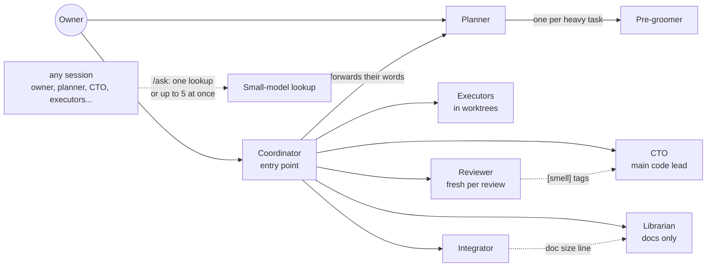
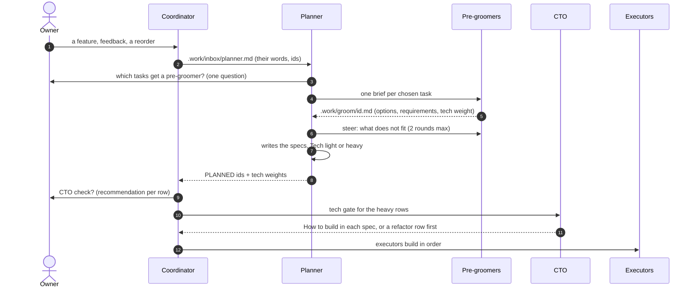
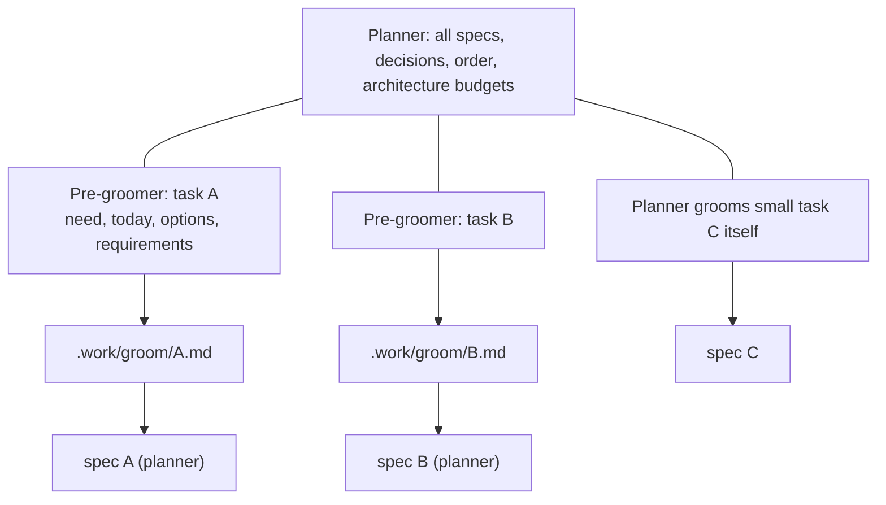
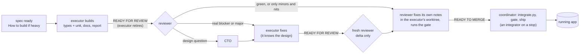
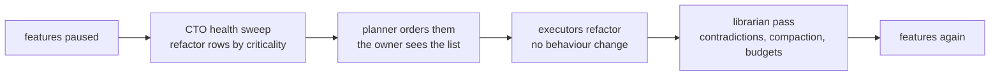
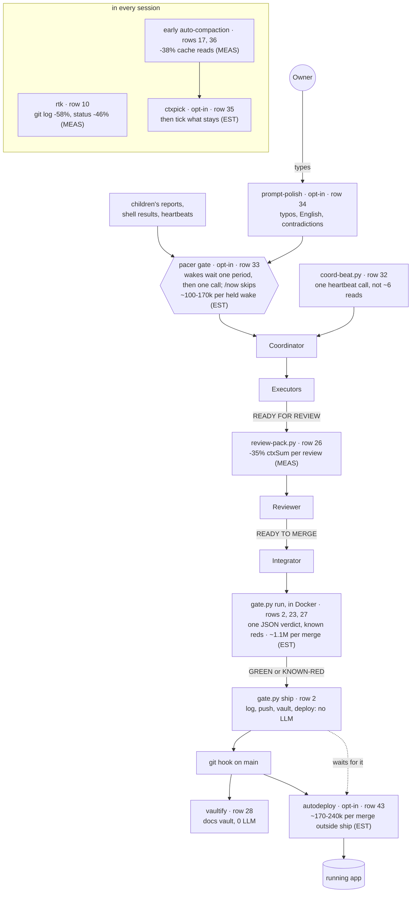
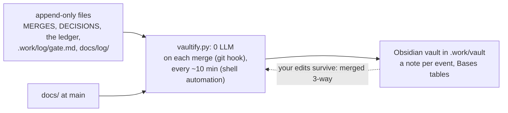

# vibecode

An opencode skill and command that set up a fresh project folder for a **multi-agent build**: you talk to one coordinator; a planner decides what to build, a CTO decides how, executors build it in worktrees, reviewers judge it before the slow tests, the coordinator merges it (an integrator steps in on a conflict or a red), and a librarian keeps the docs short. Each runs in its own session, on the model that fits its job.

- [How it works](#how-it-works): the diagrams, from [who starts whom](#1-who-starts-whom) to [the machinery around the agents](#6-the-machinery-around-the-agents) (CI, deploy, pacer, plugins and what each saves) and [the vault](#7-the-vault-what-happened-as-a-database-for-no-model-tokens) (the logs as a free database)
- [The roles](#the-roles) · [Commands](#commands) · [Keeping tokens low](#keeping-tokens-low)
- [What `/vibecode` does](#what-vibecode-does) · [Install](#install) · [Usage](#usage) · [Template flags](#template-flags) · [Layout](#layout)

## How it works

### 1. Who starts whom

The owner starts two sessions: the coordinator (the entry point) and, to plan, the planner. Everything else is started by them. Any session may hand a cheap lookup to a small model. What sits between them (CI, deploy, the pacer's gate in front of the coordinator): [diagram 6](#6-the-machinery-around-the-agents).



### 2. A big task, from the owner's words to the running app

The coordinator routes; it asks the owner once whether the CTO checks the planned rows (recommended for every `Tech: heavy` row).



### 3. T-shaped grooming

The planner is the bar: it sees every spec, decision and the order. Each pre-groomer is a stem: it digs into one task with a fresh, small context and writes a report; the planner checks it against the wide view, steers it, and writes the spec itself.



### 4. The batch loop

Review before the slow tests. A green or green-with-notes review ends in the reviewer's own fixes and gate, so the executor retires at READY FOR REVIEW; only a real major goes back to it, and a fresh reviewer then checks the delta only (docs or tools only: on the mid model). A reviewer averages ~44k context per call, an executor 86-148k. A design question goes to the CTO, a product question to the planner.



### 5. Clean stages

Every ~10 feature batches, on a critical smell, or when known red tests keep growing, the coordinator proposes a stage: no new features until the code and docs are clean again. The first one is heavy.



### 6. The machinery around the agents

The scripts and plugins between the sessions, and what each one saves. "row N" = that row in [OPTIMIZATIONS.md](OPTIMIZATIONS.md); **MEAS** = measured in the source project, **EST** = an estimate. Opt-in = off until you turn it on: the pacer, prompt-polish and ctxpick come with `deploy.py --global`, autodeploy with one line in `.work/ci/machine.json`. The pacer is a gate in front of the coordinator: everything that would wake it (the owner's prompt, a child's report, a shell result, a heartbeat) waits for one period and goes in as one model call.



| Piece | Where it lives | Row |
|---|---|---|
| prompt-polish, pacer, ctxpick, todo (news) | `templates/opencode-global/` (your OpenCode config, not the project) | 34, 33, 35, 47 |
| coord-beat, review-pack | `tools/work/` | 32, 26 |
| merge cause (`cause.py`, `merge-log.py --from`), cache-ttl, tokens-since, union | `tools/work/` | 46, 51 |
| friction (environment errors lanes worked around, clustered) | `tools/work/friction.py` | 72 |
| doubt (code files lanes looked up the reason for, or flagged) | `tools/work/doubt.py` | 74 |
| gate run + ship, known reds, autodeploy | `tools/ci/` ([its README](skills/vibecode/templates/always/tools/ci/README.md)) | 2, 23, 27, 43 |
| vaultify (docs and logs as notes, table views) and its git hook; the gate's history log | `tools/vault/`, `tools/ci/gate.py` | 28, 54, 71 |
| rtk, compaction config | `AGENTS.md`; the compaction snippet from `deploy.py --global` | 10, 17, 36 |

### 7. The vault: what happened, as a database, for no model tokens

The sessions already append to files: the merge log, decisions, the coordinator's ledger, the gate's history. A script turns those and the docs into an **Obsidian vault**: one note per batch, merge, decision, question and **log line**, each line's `key=value` fields as properties, and table views (Bases) that filter, group and sort them: reds by test and machine, merges by day, every spawn of a lane. **On by default.**



| | |
|---|---|
| **Cost** | building: 0 model tokens (~1 s for ~750 events, measured once). Writing: only the lines agents already append, ~100 output tokens each (EST). No agent reads the vault |
| **Open** | `<main checkout>/.work/vault` as a vault in Obsidian 1.9+; Dataview reads the same properties |
| **Your edits** | kept: the next build merges into them; a clash is parked, never overwritten |
| **Not a code project?** | research, writing, ops: the coordinator proposes a log shape for your events (`SOURCE`, `CLAIM`, `DEPLOY`, `INCIDENT`...) |
| **Off** | `deploy.py <target> <answers> --no-vault` |

What's logged, who writes it, the cost model, the line format and the ideas not built yet: **[skills/vibecode/vault.md](skills/vibecode/vault.md)**.

## The roles

| Role | Does | Model (picked at setup) |
|---|---|---|
| **Coordinator** | the owner's entry point: routes what they say, runs the lanes, keeps every machine busy with a ~10-minute heartbeat, resumes sessions after a usage limit, recommends model and effort, reports status (flags stale built branches) and reminds of blockers | mid model, medium effort |
| **Planner** | grooms in breadth: vision, specs, order (built work first); asks once per pass which tasks get a pre-groomer; takes a queue of jobs per session | top model, high effort |
| **Pre-groomer** | one per heavy task (the stem of the T): options, requirements, how it should feel | top, high |
| **CTO** (main code lead) | architecture; a `How to build` section for heavy specs before they are built; health sweeps that turn smells into refactor rows with criticality (YAGNI, KISS, DRY, SOLID, DDD-lite; errors, logging, security) | top, high (xhigh for a sweep) |
| **Librarian** | docs only: contradictions, compacted decisions, stale data removed, doc size budgets so every session reads less | mid, high |
| **Executor** | builds one batch (or a chain) in its own worktree, test-first, by a short "How to build" list in the spirit of [ponytail](https://github.com/DietrichGebert/ponytail): the smallest complete change, reuse first, deletion beats addition | top, medium (high when it needs thinking) |
| **Reviewer** | reads the diff against the spec before the slow tests; on green fixes its own minors and runs the gate (`READY TO MERGE`); tags blockers and majors by cause and structure problems `[smell]` for the CTO; a delta review of docs or tools only runs on a mid model | top (mid for such a delta), high, fresh per review |
| **Integrator** | short-lived (~4 merges or 150k context): merges reviewed batches from its brief, a queue file and the report, never the specs; runs the gate, ships (push, vault, redeploy after code merges; with autodeploy on the app follows `main` by itself), writes the roadmap's "What's new" and a doc size line | mid, high |
| **Lookup helper** | `/ask`: finds a fact in the docs or code with `grep` and answers in 10 lines with `file:line`; up to 5 numbered questions in one call, each answered under its number | small, low |

## Commands

Every role gets an opencode command in the new project, each setting its own model, so you can talk to any of them in a new session at any time:

`/coordinator` · `/planner <what to groom>` · `/cto <job>` · `/librarian <pass>` · `/pregroom <task>` · `/reviewer <id> base head` · `/builder <batch>` (solo) · `/ask <question, or 1. .. 5. questions>`

## Keeping tokens low

- **Read less:** doc budgets and start reads (`tools/work/check-docs.py`), a big file read whole once, outlines (`tools/work/map.py`) and `git grep` before reading code.
- **Wait less:** long runs in the foreground, never polled (polling was 37% of integrator cache reads); a small live queue file.
- **Carry less:** role sessions retire at ~200-250k, integrators after ~4 merges, reviewers fresh; lanes auto-compact early.
- **Wake less** (opt-in): the pacer holds the coordinator's wake-ups for one period and sends them as one model call.
- **Look for it:** the coordinator audits each retired session (`tools/work/session-audit.py`) and turns repeat smells into fixes.

Every cut, its measured or estimated saving and its status: [OPTIMIZATIONS.md](OPTIMIZATIONS.md).

## What `/vibecode` does

1. **Checks the folder.** Empty or almost empty: goes on. Existing files: asks before deploying around them (nothing is ever overwritten).
2. **Takes the idea.** The command's arguments, or it asks for 2 to 5 sentences.
3. **Interviews you once** (one question-tool call): scale, reviewers, hardware, tests, how model use is paid.
4. **Probes the machines** (OS, cores, RAM, GPU, tool versions; optionally a second machine over SSH) and picks an executor count.
5. **Picks models and effort** per role from the models actually available to you.
6. **Deploys the templates** with `scripts/deploy.py`: `AGENTS.md`, `docs/` (vision, planning, backlog, roadmap, decisions, handover, machines, measurements, prompts, spec template), role briefs under `docs/workflow/` (with these diagrams as `workflow.html`), the role commands under `.opencode/commands/`, scripts under `tools/work/` (integration, merge log, worktrees, test locks, remote runs, the docs budget check, a doc finder, a code outline, the session token audit, the coordinator's heartbeat, the review pack), the local CI gate (and opt-in autodeploy) under `tools/ci/` and the docs vault under `tools/vault/` (its git hook installed; `--no-vault` leaves it out). Then `git init` and a first commit; it never adds a remote or pushes.
7. **Prints the session prompts** with model and effort: the planner prompt to paste first, then the coordinator (or solo builder) prompt. They are also kept in `docs/PROMPTS.md`.

It writes no product code; the planner session plans the product.

## Install

Copy the two pieces into your opencode config:

```sh
cp -r skills/vibecode ~/.config/opencode/skills/
cp commands/vibecode.md ~/.config/opencode/commands/
```

Claude Code users may put the skill in `~/.claude/skills/` instead.

**Optional, for your own OpenCode** (not per project): `python -I -X utf8 skills/vibecode/scripts/deploy.py --global`
installs the prompt-polish plugin, the ctxpick TUI plugin, the pacer and the todo list (`/todo`, the coordinator's
📌 lines) into your OpenCode config folder where missing,
then prints the `cli.json` line and a compaction config snippet to merge by hand. It never edits your configs. Details:
`skills/vibecode/templates/opencode-global/README.md`; how the pacer batches and paces:
`skills/vibecode/templates/opencode-global/pacer.md`.

## Usage

Make a new folder, open opencode in it, and run:

```
/vibecode [idea]
```

## Template flags

The interview answers decide which template sets are deployed:

| Flag | Options | Effect |
|---|---|---|
| **Scale** | `team` · `fleet` · `solo` | team: coordinator + integrator + 2-3 executors; fleet: up to 6 executors, lanes on a 2nd machine; solo: one builder session runs the loop itself |
| **Reviewers** | `all` · `risky` · `none` | a fresh reviewer session per batch, only for risky batches, or none |
| **Tests** | `unit` · `e2e` · `perf` | e2e adds a shared stack and lock scripts; perf adds a performance gate on one reference machine |
| **Remote** | on · off | a second machine over SSH for test runs and builder lanes |
| **Vault** | on (default) · off | on: `tools/vault/` and its git hook ([section 7](#7-the-vault-what-happened-as-a-database-for-no-model-tokens)); off: `deploy.py ... --no-vault` or `"VAULT": false` in the answers |

## Layout

```
skills/vibecode/SKILL.md          the skill
skills/vibecode/scripts/deploy.py copies and fills the templates
skills/vibecode/vault.md          the vault: append-only logs as a zero-LLM database
skills/vibecode/templates/        always/ team/ solo/ reviewers/ e2e/ remote/ (opencode-global/: opt-in, deploy.py --global)
commands/vibecode.md              the /vibecode command
```
