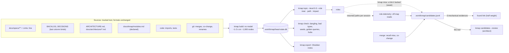

# Knowledge and roles: who plans, who orders, and how every role finds what relates

The design behind four changes to the workflow: the planning roles get clear owners (product lead, architect, plan reviewer; the coordinator owns the order), a no-model **knowledge map** (`tools/kmap/kmap.py`) answers "what relates to X" for every role, **role telemetry** (`tools/work/role-telemetry.py`) measures which roles bypass their tools, and a checked-in **job manifest** is planned for the background scans. It was distilled from two research passes on a real project (a canvas IDE: ~1,900 specs, decisions and code files, five parallel lanes). **MEAS** = measured there, **EST** = an estimate with its math, **UNVERIFIED** = not checked.

- [1. What changed, in one table](#1-what-changed-in-one-table) · [2. The roles](#2-the-roles) · [3. Models](#3-models-and-when-each-runs)
- [4. The knowledge map](#4-the-knowledge-map-kmap) · [5. Telemetry and the enforcement ladder](#5-role-telemetry-and-the-enforcement-ladder)
- [6. Role evals](#6-role-evals) · [7. Background jobs](#7-background-jobs) · [8. Rollout](#8-phased-rollout) · [9. How the two designs were reconciled](#9-how-the-two-research-designs-were-reconciled)
- [10. Open questions](#10-open-questions-and-the-defaults-shipped) · [11. Later: non-coding projects](#11-later-non-coding-projects)

## 1. What changed, in one table

| Change | Why (evidence) | Where |
|---|---|---|
| **Planner → product lead, CTO → architect** | The pair reads as what/why ↔ how (the product-manager → architect hand-off of multi-agent frameworks); "product owner" would imply it orders the backlog, which it no longer does | `docs/workflow/product.md`, `architect.md`; `/product`, `/architect` |
| **A fresh plan reviewer per planning pass** | Nobody checked a plan against the owner's words: the author graded itself. **30 of 136** tagged blockers and majors in the source project's reviews were `[spec-gap]` (MEAS) | `docs/workflow/plan-review.md`, `/plan-review` |
| **The architect gates every pass** (heavy: `## How to build`; light: a one-line `Fit:`) | Before, it saw only `Tech: heavy` rows, and only when the owner said yes to a separate question | `architect.md` "Jobs" |
| **The coordinator owns the backlog's order** | The owner's priorities lived in the coordinator's checkpoint, not in the backlog (MEAS), so a planning pass could revert them. A reorder by the warm coordinator is ~$0.1-0.2 vs $1+ to wake a planning session (EST) | `tools/work/order.py`, `PLANNING.md` "The order", `coordinator.md` |
| **Roles retire at ~140k, not 250k** | The planning sessions' model alias auto-compacts at ~150k (`limit.input` 214,286 × 70%), so "retire at 250k" never fired: they compacted **5-34 times a session** (MEAS) | `product.md`, `architect.md`, `coordinator.md`, `opencode.snippet.jsonc` |
| **Knowledge map, phase 1** (no model) | Agents walked docs link by link and grepped wide: one `git grep` for a feature word returned **234k chars** (~58k tokens) of hits (MEAS); a map answer is ~1 KB | `tools/kmap/kmap.py`, `docs/kmap/`, the spec's `Links:` line |
| **Role telemetry with an enforcement ladder** | **19-39%** of each role's shell calls were raw commands a project tool covers (upper bounds, MEAS over 7 days); helpers typed inline again and again (`cut` 243×, `show` 113×, `rep` 106× in 7 days) | `tools/work/role-telemetry.py`, `docs/workflow/telemetry.md` |
| **Thin briefs, knowledge on demand** | The planning roles carried 86-96k of context by their tenth call (MEAS) | the three briefs ≤ 40 lines; `PLANNING.md` and the spawn prompts read by section |

## 2. The roles

```mermaid
sequenceDiagram
  autonumber
  actor O as Owner
  participant C as Coordinator
  participant P as Product lead
  participant S as Pre-groomers
  participant A as Architect
  participant R as Plan reviewer (fresh)
  O->>C: idea, feedback, "X first"
  C->>C: an order word: order.py word, BACKLOG in that turn
  C->>P: .work/inbox/product.md (their words verbatim, ids)
  P->>S: one per heavy task (the owner's pick, one question)
  S-->>P: .work/groom/id.md
  P->>P: specs with Links lines; new rows where it proposes
  P->>A: the gate: How to build (heavy), Fit (light)
  A-->>P: sections written, open edges back
  P->>R: .work/plan/pass/ (words.md, pass.md)
  R-->>P: plan-review.md: verdict and coverage table
  P->>O: ONE question: open calls and the review's owner items
  P-->>C: PLANNED ids tech=.. review=..
  C->>C: order.py check, then lanes
```

**Why the product lead parents the pass.** OpenCode subagents nest one level, so a planning session started by the coordinator could not start its pre-groomers; it already ran as its own session. Making it the parent of the whole pass (pre-groomers, the architect's gate, the plan review) means one owner yes covers it and the coordinator gets one reviewed result. The architect's sweeps and single design calls stay the coordinator's.

### Who owns what

| Thing | Owner | Others |
|---|---|---|
| The **order** of BACKLOG rows (the build order), holds, drops | **coordinator** (solo: the product lead) | the product lead adds rows where it proposes, with one line of why; only the owner of the order moves an existing row |
| What a row **is**: its spec, split, merge, scope, `needs grooming` → ready | **product lead** | the coordinator holds a row on a scope word and queues the product lead |
| `Waits on`, `Same files as`, refactor rows and their criticality | **architect** | the product lead may draft them; real code reasons only |
| The owner's standing word on order | **BACKLOG itself** + `docs/log/order.md` WORD lines | no priority list anywhere else, the coordinator's checkpoint included |

**The order word, once.** `order.py word "<their words>" --rows <ids> --top | --after <id> | --before <id> | --hold | --drop [--needs "product: <what>"]` moves or holds the rows (each named row must be there exactly once, or nothing is written), stamps `(owner <date>)` on their status, renumbers, and appends a vault-shaped `WORD` line. `order.py check` (on each `PLANNED` and after another session's backlog commit) finds a row twice, a broken `#` column, a stamped row with no word, and a row whose newest word no longer holds: a `top` row under an unstamped one, `after`/`before` broken, a held row not held, a dropped row back. The coordinator applies only mechanical rules unasked (built work first, a real blocker of built work next, an open dependency waits); a judgement (a tier never stated, a split, a re-scope) is one line to the product lead.

**The plan reviewer** reads the pass folder (`words.md`: the owner's words verbatim; `pass.md`: ids, tech weights, pre-groomers' reports, rows added), each spec and `kmap.py <id> --role plan-review --level 1`, and checks fidelity (every owner sentence maps to a rule, a `not this batch` or a listed difference), what was overlooked, the architecture, testability and the order. Verdict `PLAN OK` / `PLAN OK WITH NOTES` / `PLAN CHANGES`; findings tagged `[fidelity] [missing] [conflict] [arch] [testable] [order]`. It never edits and never asks the owner; a finding against an explicit owner word becomes a question in the product lead's one question call, never an override. Cost: ~$2-2.5 per pass on the top model (EST from the reviewers' median of 26 turns at 62k context, with a bigger pack), ~10% on top of a planning pass; catching a third of the `[spec-gap]` findings before they are built roughly pays for it (EST: each costs a fix round, ~$1-3 plus gate hours).

## 3. Models and when each runs

| Role | Model (answers key) | Runs |
|---|---|---|
| Product lead | `M_PRODUCT`: top, or a premium model above top **only with the owner's word** per pass | each planning pass; the owner's own session or the coordinator's spawn |
| Architect: gate, sweep | `M_ARCH`: as the product lead | the gate: inside each pass (the product lead starts it); sweeps: clean stages (the coordinator) |
| Architect: a single design call | `M_ARCH_QUICK`: top, high | a builder's or reviewer's question the spec does not answer |
| Plan reviewer | `M_PLANREV`: top, high, a **different model than the author** when possible (other blind spots) | once per pass that makes a spec ready, fresh |
| Pre-groomer | `M_PREGROOM`: top, high | one per heavy task, the owner's pick |
| Map upkeep (later: cards, link typing) | the mid and small models; **never the premium one** | nightly or in a librarian pass, never in a merge's path |

**The premium model's real price.** On the source project's last 7 days, the same tokens cost **~1.6× on the premium model than on the top one, not the 2× of its list price**, because cached reads (most of a long session) cost the same on both (MEAS: planning pass median $21.4 vs $13.3; architect job $6.5 vs $3.6). The two planning roles were **12.4%** of the week's API-equivalent spend; putting them all on the top model would have saved ~4.6% of the total (MEAS-derived). These are the roles whose mistakes get built, reviewed and merged, so the default keeps the premium model there, behind the owner's word per pass, and moves quick calls and the review to the top model. Under a plan quota rather than API prices the binding limit may be the premium model's own cap; the same split holds.

**Compaction.** The planning roles retire at ~140k, before their alias compacts at ~150k (`opencode.snippet.jsonc`). The alternative is an alias with `limit.input` ~357k (compaction at ~250k with the 30% buffer) and a retire line at ~240k: a wider view per session at ~$0.04 per turn more in cache reads at 200k (EST). Open question 2.

## 4. The knowledge map (`kmap`)

**Goal:** a role asks one question ("what relates to `minimap-shift`?") and gets a short, ranked answer with the reason for each line, a level of detail it chose, and a signal to stop, so it never walks links by hand or greps the whole tree. **No model builds it** and nobody "reads everything".



### 4.1 Schema (phase 1, shipped)

One SQLite file per HEAD and worktree state, in the **main checkout's** `.work/kmap/` (8 kept, least recently used dropped). The key is the HEAD sha plus a hash of every source's size and time and of `kmap.py` itself, so a lane's uncommitted spec edit and a tool update both rebuild. A build is atomic (temp file + rename); two lanes building the same state keep whichever landed.

```sql
create table node(id text primary key, kind text, l0 text, path text, status text, extra text);  -- extra: JSON
create table edge(src text, type text, dst text, weight real, conf text, evidence text, primary key(src, type, dst));
create table alias(alias text primary key, id text);     -- a renamed file's old path
create table issue(level text, text text);              -- what check reports: dangling ids, bad types, missing binds
create table meta(k text primary key, v text);           -- build seconds, time
```

**Nodes** have stable ids, names never paths for docs (`spec:<id>` survives the move to `done/`): `mod:` (declared modules), `spec:` (spec files and backlog rows), `dec:<n>` (decision rows), `area:` (an architecture doc, or a folder row of `ARCHITECTURE.md`), `file:` (code; kind `test` for test files).

| Edge | Source | Weight | Trust |
|---|---|---|---|
| `depends-on`, `same-files-as` | `Depends on:` / `Same files as:` (backticked id-shaped tokens before the first period), BACKLOG `Waits on` | 1.0, 0.6 | CURATED `!` |
| `applied-by`, `applies`, `shares-ui`, `supersedes`, `conflicts`, `part-of`, `not` | the spec's `Links:` line (closed list of types) | 0.5-1.0; `not` blocks | CURATED `!` |
| `part-of` | `docs/kmap/modules.md` seeds: spec ids, paths, globs | 1.0 | CURATED `!` |
| `touches-file`, `mentions`, `cites` | backticked paths and ids in a spec's body; "decision 12" | 0.8, 0.4, 0.7 | EXTRACTED |
| `binds`, `amends` | DECISIONS' last column; "amends 12" | 0.8, 1.0 | EXTRACTED |
| `maps` | area doc table rows (a folder row: 0.3 per file) | 0.6 | EXTRACTED |
| `imports`, `tested-by` | TS/JS relative imports; Python imports by `ast` (relative, and absolute by a unique dotted suffix); tests by import and by name | 0.7 | EXTRACTED |
| `implemented-in` | the first-parent commit that moved a spec into `docs/specs/done/`: the files it changed | 0.9 | EXTRACTED |
| `co-changes` | files changed together in 3+ commits of ≤25 files, confidence ≥0.5 | 0.5 | STAT `*` |

**The `Links:` line** is the one new thing writers learn:

```text
Links: applied-by `view-later` · part-of `mod:minimap` · not `mod:islands` (only a stylesheet shared)
```

A free-text link field gets mistyped (the research found `Depends on: nothing. X applies it` parsed as "depends on X", the reverse); the closed grammar fixes that, and `check` turns an unknown type red. Free-text fields keep working: only id-shaped backticked tokens count there, so a path or a word in capitals is prose.

### 4.2 The query: levels, caps, stop signals

```text
kmap.py <topic> [--level 0-3] [--depth 1-3] [--budget N] [--role R] [--types t,..] [--why] [--json] [--session ID]
kmap.py near "<words>" | path <a> <b> | impact <topic> | list <x> | miss "<needed>" <where> | recall --log | candidates --review | check | build [--force] | stats | export --vault DIR
```

| Level | Shows | Default budget |
|---|---|---|
| 0 | one line per node: score, kind, id, one-liner, how it links (`via touches-file of spec x`) | 40 lines |
| 1 | + facts: a spec's status, tech and first rules; a file's declarations; a decision's text; a module's members | 40 |
| 2 | + sections and outlines with line numbers | 120 |
| 3 | only what to read: `read path:a-b (What must be true)`, `read file (N lines: map.py first)` | 40 |

**Ranking (the tool traverses, the agent never does):** a flow from the topic: each hop sends `0.7 × score / √degree × weight × role weight`, a node under 0.01 stops, depth ≤ 3; an edge into a file, decision or area is damped by `1 / (1 + ln degree)`, so a stylesheet every spec touches never pulls everything into everything; a `not mod:x` on the topic walls off that module and its members. `--role product|architect|plan-review|builder|reviewer|librarian` multiplies the link types that role needs (the architect: imports, co-changes, areas; the builder: implemented-in, touches, tests).

**Stop signals:** every answer ends `-- N shown of M reached; K cut by the budget, mass X fell under θ. next: ...`; a node with nothing above the threshold says `leaf: ... read <path>`; with a session id (default `$OPENCODE_SESSION_ID`) a node already shown at that level or deeper prints as `(seen)`, and the third ask of one topic at one level prints `LOOP: ... read its --level 3 list, or kmap.py miss`. An ambiguous topic exits 3 with the candidates (never a guess), an unknown one exits 4 with near names, an unknown flag exits 2. `path a b` scores a chain like one strand of the flow and calls it weak under 0.05 ("only through the hub X; probably unrelated for this job").

### 4.3 The link pipeline: who builds which links

| Tier | Links | How | When | Model |
|---|---|---|---|---|
| **A exact** | everything in 4.1 but co-change | parsers over the template's doc shapes, `git log --first-parent`, imports | each query whose state has no map yet (~1-2 s) | none |
| **B statistics** | co-change; later per-test coverage | git history | same | none |
| **C candidates** (later) | `shares-ui`, `conflicts`, `not`, re-typing legacy free text, module cards | candidates made by code: specs sharing 2+ non-hub files with no link, co-change pairs no doc links, MISS lines, stale cards | nightly ≤ 20 pairs, or the librarian's pass | small model for pairs, mid for cards; never the premium one |
| **D curated for free** | `Links:`, `not`, modules | roles that already read the material: the product lead writing a spec, the architect writing `How to build`, a reviewer's miss | as they work | their own session |
| **E behaviour** (later) | confirms or refutes A-D | a merge's diff against what the map predicted; MISS lines | each merge | none |

A model-made link (tier C) must quote evidence the tool finds verbatim at its sha, carries its confidence and origin, counts half, expires after 10 merges touching an end, and is audited weekly (a type under 0.7 precision is turned off). It never writes `depends-on` (the product lead's) or a decision's `supersedes`.

### 4.4 Decay checks

| Check | Detects | Now |
|---|---|---|
| **Dangling** (red; a warning in `done/` specs, whose links rot by design) | a curated id that names nothing | ✅ `check` |
| **Bad link type** (red) | a `Links:` item outside the closed list | ✅ |
| **Module seed** (red) | a seed or glob that matches nothing | ✅ |
| **Golden queries** (red) | `docs/kmap/golden.md`: `` - `topic` has `a` `b`; not `c` `` against the top 20 | ✅ |
| **Hubs** (warning) | degree over max(30, p99): the architect splits it or keeps it as a hub | ✅ |
| **Orphans** (warning) | an open spec in no module; a module with no member; a decision binding a missing file | ✅ |
| **Brief recall** (the decay meter) | at each merge, the files the map would have pointed at vs the files the merge changed: `RECALL batch= recall= precision=` in the vault | phase 2 |
| **Stale cards** | an anchored card whose anchors' fingerprint changed (`?` in every answer) | phase 4 |

On the source project, the shipped `check` found **22 dangling ids in open specs** (renamed or never-written specs) and 28 more in built ones, and listed its 10 biggest hubs, 97-318 links each (MEAS, one run).

### 4.5 Obsidian export

`kmap.py export --vault .work/vault` writes `mesh/` beside the docs vault: one note per module, spec and area with typed links as body lines (`- needed-by [[mesh/spec/view-later|view-later]] (curated)`) and its files listed inside it, never a note per code file (a thousand notes is a hairball). **The export always regenerates:** every note and `index.md` start `generated by kmap at <sha>; edit the source, not this note`, and a gone node's note is deleted. Edits belong in the sources in git. The vault build calls it after every merge.

**Misses are found by code, never by a model.** Three sources feed `.work/kmap/candidates.jsonl`: recall misses (the files a merge changed that the map at its parent did not return), co-change (both ends changed in 3 **distinct** merges) and off-map reads (files a session read that its queries never returned). A `kmap miss` self-report is weak evidence and never promotes alone. Three mechanical evidences (or one self-report and one mechanical) make a `found` link at half weight. It expires after 10 merges on one of its ends. Every window counts merges on the pair's own ends, never the whole repo's, since a busy main would expire everything. The rest waits for the architect's `kmap candidates --review`. **A rejection is a snapshot:** it re-opens when an end's fingerprint changes, on new evidence, or after 20 merges changing either end (30 days at most).

### 4.6 Measured on the source project (0 model tokens)

| Measure | Value |
|---|---|
| Research proof: nodes / links | 1,264 / 9,087, built in **2.1 s cold, 0.4 s warm** |
| Shipped `kmap.py` on the same tree | 1,904 nodes / 10,692 links (tests and decisions included), **~1.8 s** warm build (17 s on a cold disk cache), **~0.5 s** per query |
| Would it have pointed a builder at the right files? Leave-one-out over 181 merged specs, top 20 files | **49%** of the files the merge changed (**58%** of those that existed before it), precision 0.40; the spec's own file mentions alone: 28% |
| Files a merge created | 11% of its code files: no map can predict them (an answer adds the area's "where a new thing goes") |
| One answer | ~1.1 KB (~275 tokens), against 234k chars of `git grep` hits for the same word |

**The 49% is optimistic:** the proof read spec text at HEAD (a spec edited after its merge leaks a little) and counted co-change including the merge itself. A true replay at each merge's first parent is phase 2's baseline.

### 4.7 What was not adopted, and why

GraphRAG, LightRAG, Cognee, Graphiti, mem0: each needs a model over the whole corpus, a server or a graph database. A hand-kept Obsidian vault as the store: every writer keeps links, and markup in repo docs costs every reader. A code-index server (LSP): measured in the source project as no saving, the wrong worktree, a missed string key. Borrowed instead: validity windows (Graphiti) as first/last sha and expiry, extracted/inferred tags and a query budget (graphify), flow pruning (PathRAG), anchored and re-verified cards (Swimm), progressive disclosure (agent skills), an `Optional` tail (llms.txt).

## 5. Role telemetry and the enforcement ladder

`role-telemetry.py` reads the opencode database read-only. A session's role: its agent name, else its brief (`lane-brief`, `docs/workflow/product.md`, `You are the coordinator`...), else a title tag; old names map (planner → product, cto → architect). Each finished tool call is a **tools/ run**, **replaceable** (a raw command a project tool covers, with the tool), **ad-hoc** (an inline script), **raw** or **builtin**; a whole read of a doc that is searched by section counts as replaceable. Inline helper definitions are counted by name. **Off-map reads:** in a session that asked `kmap.py`, a read of a doc or code file the map never returned (start reads excepted). This is where the two research designs met: the raw-command counts say a role ignores its tools, the off-map reads say the map lacks a link or the role ignores the map, and both come from one scan.

| Role (7 days, 466 sessions, MEAS) | Sessions | Replaceable share of shell calls | Top replaceable → tool |
|---|---|---|---|
| executor | 89 | 19% | docs greps, whole doc reads, definition greps → `find.py`, `map.py --find` |
| coordinator | 9 | 20% | status sweeps 261 → `coord-beat.py` |
| reviewer | 129 | 25% | review diffs 189 → `review-pack.py` |
| integrator | 2 | 30% | docs greps, polling |
| architect | 10 | 25% | whole doc reads, definition greps |
| **product lead** | 8 | **39%** | whole doc reads 153, docs greps 139 (`find.py --section` used 11 times) |
| librarian | 4 | 39% | |

The counts are **upper bounds**: a spot check of 10 hits per rule found the definition-grep rule ~10/10 right, the docs-grep rule ~7/10, the whole-doc-read rule ~3/10 (most were small notes meant to be read whole); the template's rule only counts tracked `docs/**.md` reads now. 17 of the 466 sessions stayed unattributed. A 7-day scan of the 795 MB database took 5.4 s.

**Flags** (each alerts once with `--state`): a share 5 points over the role's baseline (the first run is the baseline: every role was over 15% on day one, so a fixed bar would alarm forever), a rule new in a role's top three, a role with 3+ sessions and no tools/ run (a tool broke or a brief lost its line), a helper typed 10+ times in 3+ sessions, half of 20+ reads off the map.

**The ladder** (`docs/workflow/telemetry.md`): 1. read three examples (a false alarm tunes the rule, with a test) → 2. a tool gap gets built → 3. a lesson with its guard → 4. one brief line `<raw> -> <tool>` (next week −50%, else back to rung 1) → 5. a per-role permission that refuses the pattern with a message naming the tool, **only on the owner's yes** → 6. a hard `deny`, only for what `AGENTS.md` already forbids in words. **Measured, not blocked:** OpenCode's grep permission matches the regex, not the path, and a shell runs with the user's full authority, so rules stop accidents, not a determined agent; and a configured shell deny makes the scanner refuse any command it cannot parse, which many here-string commands are (UNVERIFIED how often). A spawned session never gets an `ask` rule: nobody answers it and the lane stalls.

## 6. Role evals

| Level | What | Model cost | When |
|---|---|---|---|
| **L0 static** | each brief ≤ 40 lines with its start-reads line (`check-docs.py` holds the budgets); every tool a brief names exists and refuses unknown arguments; unit tests for each tool (`kmap`, `order`, `role-telemetry` ship with them) | 0 | every commit touching `docs/workflow/` or `tools/` |
| **L1 replay** (phase 3) | recorded session exports → telemetry classification and report-line regexes stay stable | 0 | same |
| **L2 live** (phase 4) | a fixture project with seeded state; `opencode run --agent <role> --title "EVAL <case>" ...`; scored from the database by session | ~$0.5-2 per case on the top model (EST), 3 repeats, pass 2 of 3 | on a brief, tool or model change |

An L2 case: `{"id", "role", "fixture", "prompt", "must_call": [...], "must_not_call": [...], "max_turns", "max_ctx_sum", "max_cost_usd", "report": "<regex>", "files_changed_only": [...], "judge": "<one line a cheap model scores only when regexes can't decide>"}`. Seeded defects (mutation tests for roles): the plan reviewer must catch an owner sentence no spec covers, a light row crossing two areas and a dependency with no code reason; the architect must refuse to call a two-area row light; the coordinator, given an owner word against the backlog, must run `order.py word` in that turn; an executor asked where a symbol is defined must use `map.py --find`; the product lead must write the owner's words before the spec. A full run: ~12 cases × 3 × $1-2 ≈ $36-72 (EST).

## 7. Background jobs

The coordinator used to create its no-model shell automations by hand and recreate them at a handover. On the source project, 2 of 3 live jobs were PowerShell-only and the second machine (macOS, no pwsh) ran none (MEAS). Now:

1. **`tools/jobs/jobs.json`**, checked in: `{name, every, run, os?, alert_exit?}` per job and one `prefix` (the project's name). It ships role telemetry every 4 hours.
2. **`jobs.py run <job>`**: one Python entry point (no shell syntax of its own), so Windows and macOS run the same command. An exit in `alert_exit` (role telemetry's 1: a NEW flag) prints ALERT and exits 0, so the automation reads as fired, not failed.
3. **`jobs.py sync [--apply]`** on each machine, from the checkout the jobs run from: writes each job as `<py> -I -X utf8 <root>/tools/jobs/jobs.py run <job>` through OpenCode's automation API (experimental at the time of writing; without `--apply` it only prints the calls), replaces a changed one and deletes `<prefix>` jobs no longer in the manifest, never another's.
4. No code-mode automations for watchdogs (one paused when the tool it called disappeared); prompt automations only for self-wakes (each costs a model call).

Status: **built** (`roles-2`); a heartbeat check for a late or failing job is not. Whether the OpenCode service starts at login on each OS is UNVERIFIED.

## 8. Phased rollout

| Phase | Work | Exit test |
|---|---|---|
| **1 (shipped)** | the role names and briefs, the plan reviewer, the architect's gate on every pass, `order.py` and the coordinator's order; `kmap.py` build/query/near/path/impact/miss/check/export with no model; the `Links:` line, `docs/kmap/modules.md`, `golden.md`; `role-telemetry.py` with the ladder; retire at ~140k | unit tests green on fixtures (kmap 13, order 4, telemetry 6); every deploy variant passes `check-docs.py` |
| **2** | role agent files (`.opencode/agents/<role>.md`, shipped: generated from `tools/work/roles.json` by `roles.py gen`, checked by `roles.py check`), so the database names each session's role; `kmap.py brief <spec> --role` in the lane and reviewer commands' shell blocks; `kmap check` in the gate's docs part; a RECALL line per merge and its true-replay baseline; the jobs manifest; `vaultify` calls `kmap export` | recall baseline published; no lane stalls on a permission; jobs run on both OSes |
| **3** | per-role multi-tools: a shared core (`look`: kmap, then `find.py`, then `map.py --find`; `show <file>[:a-b]`; `rep` exact-once replace; output cut to width) and role verbs (`product.py words add`, `arch.py gate`, `planrev.py pack`); L1 replays | the inline helpers' count down by half; the replaceable share down per role |
| **4** | tier C: cards for the top modules by open specs, candidate link typing, quote checks, expiry, the weekly audit; L2 live evals | audit precision ≥ 0.7 per type; recall up against phase 2 |

## 9. How the two research designs were reconciled

| Point | One said | The other said | Decision and why |
|---|---|---|---|
| Role multi-tools vs the map | a `look` verb in each `<role>.py`, calling kmap when it exists | `tools/role/<role>.py` wrappers around kmap, find, map | **one engine:** `kmap.py` is the only index (roles weigh it with `--role`); the multi-tools (phase 3) are thin wrappers in `tools/work/` (one place, one permission pattern), never a second index. Until they exist, briefs name only tools that exist, so the brief lint can check them |
| Telemetry | role tool use from raw-command rules; fold friction, doubt and the audit into one tool | off-map reads per role, from what kmap returned | **one scan, both signals:** `role-telemetry.py` counts raw commands and joins kmap's per-session returned paths for off-map reads. Folding friction and doubt in waits until they need shared state: they already run, with their own tests |
| Enforcement | a 6-rung ladder, permission nudges before hard denies | permissions are guardrails, not a sandbox; deny only what the rules already forbid in words | **the ladder, with the second's limit on rung 6**; the default is measured, not blocked |
| The premium model's price | ≈2× the top model (list price) | ≈1.6× on real sessions (cached reads cost the same) | **1.6×, measured**; both agree it never does map upkeep and needs the owner's word per spawn |
| Who starts the architect | the coordinator, after a question to the owner | the product lead, inside the pass | **the product lead** (one owner yes, one reviewed result); sweeps and single calls stay the coordinator's |
| The map's cache key | the HEAD sha | (same) | **HEAD plus the worktree's state:** a lane's unmerged spec edit must show in its own answers |
| Name lookup | SQLite FTS5 with trigrams | - | **plain substring match in memory** for phase 1 (≈2k nodes answer in milliseconds, and it works on any SQLite build); FTS5 when a project passes ~20k nodes |
| Retiring | 200-250k (the old briefs) | compaction fires at ~150k | **~140k**; the wider alias is open question 2 |

## 10. Open questions, and the defaults shipped

Each default is in the templates and can be changed where named.

| # | Question | Default shipped (where to change) |
|---|---|---|
| 1 | Names `product` / `architect` / `plan-review`? | yes (`docs/workflow/`, `.opencode/commands/`; old answer keys `M_PLANNER`, `M_CTO` still deploy) |
| 2 | Retire the planning roles at ~140k, or a ~357k alias and retire at ~240k? | ~140k (`product.md`, `architect.md`, `coordinator.md`, `opencode.snippet.jsonc`) |
| 3 | Plan review on every pass, or only passes with a heavy or new-feature spec? | every pass that makes a spec ready (`product.md` step 5) |
| 4 | Does one owner yes for a pass on the premium model cover its gate and review? | yes (`product.md` step 5, `coordinator.md` "A big task") |
| 5 | May the coordinator apply the mechanical order rules unasked? | yes: built work first, blockers, open dependencies; judgement goes to the product lead (`PLANNING.md` "The order") |
| 6 | Permission nudges (rung 5) automatically after a week, or per rule on the owner's yes? | per rule, on the owner's yes (`telemetry.md`) |
| 7 | Modules declared or computed? Cards tracked in git? | declared (`docs/kmap/modules.md`); cards tracked, ≤ 3 KB each, when phase 4 comes |
| 8 | Turn the model tier on when? | after phase 2's recall baseline, and only if recall stops rising |
| 9 | Should a link the owner adds in Obsidian become a suggestion the librarian confirms? | not yet: the export keeps the owner's edits, nothing reads them back |
| 10 | `kmap` beside `find.py`, or one tool? | beside (relations vs words); merge as `kmap find` later if both stay used |

## 11. Later: non-coding projects

The same roles, renamed outputs. A research-then-build project (say, research forums, then build a bot): the coordinator runs researchers and accepts their digests; the product lead writes research questions, scope and "what would change the owner's mind"; the architect owns the method (sources, taxonomy, data schema), later the bot's architecture; a researcher takes one question to a digest with citations; the reviewer fact-checks claims against sources; the plan reviewer is unchanged; the librarian keeps the knowledge base, which is the knowledge map with code extractors off and modules as topics.

- **Common, versioned with this skill:** the `AGENTS.md` rules, role briefs, the tools' core, telemetry, jobs, evals.
- **Per project:** the map's extractors keyed by the project's doc shapes, its log lines (`SOURCE`, `CLAIM`; the vault already turns any such log into notes), its gates (a research gate: every citation resolves, every claim sourced, nothing UNVERIFIED published).
- **Without git:** worktrees become per-task folders, a merge becomes an accept step, the order stays in one `BACKLOG.md`, logs stay append-only; `kmap.py` already builds without git (no git links).
- **Sync:** a project pins this skill's version and upgrades by a 3-way merge of briefs and tools (as the vault merges the owner's edits); lessons tagged general are proposed upstream, with the owner's yes.
